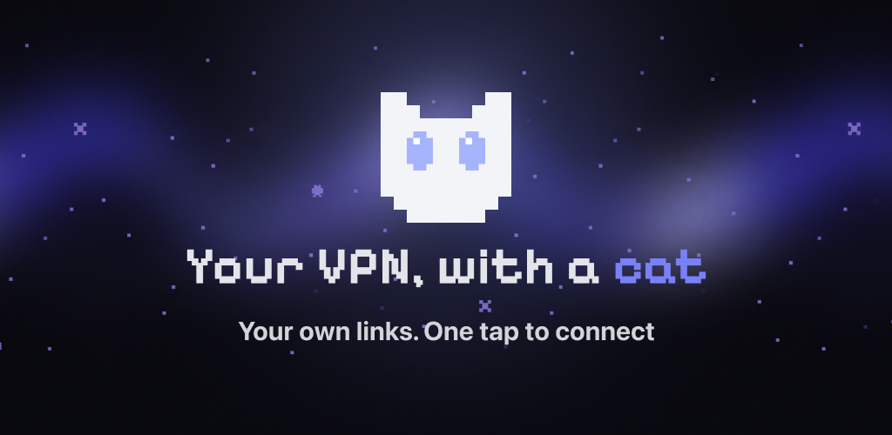
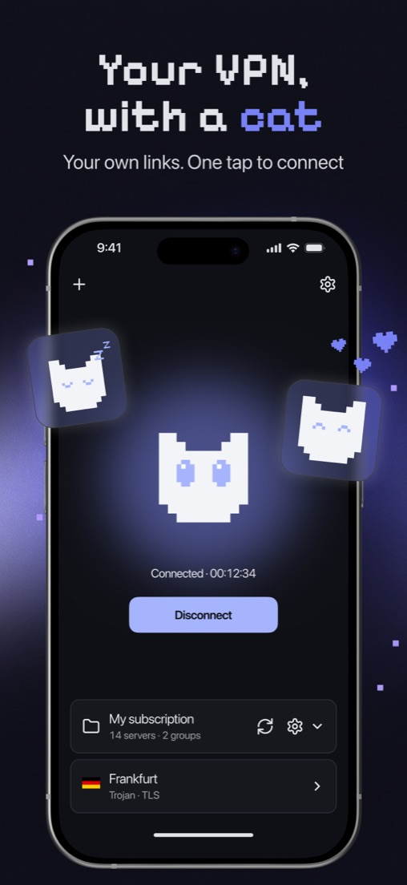
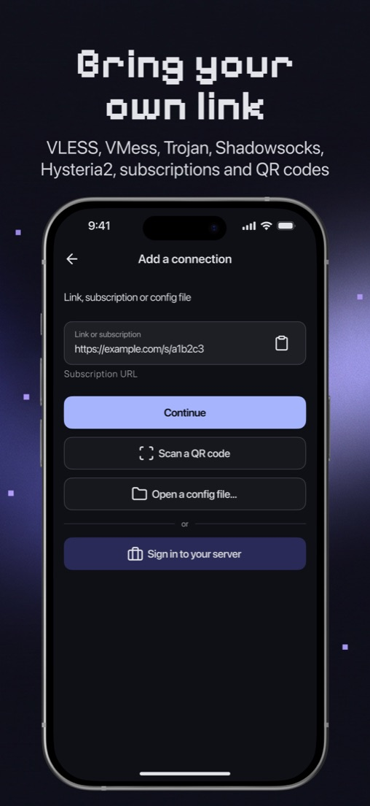
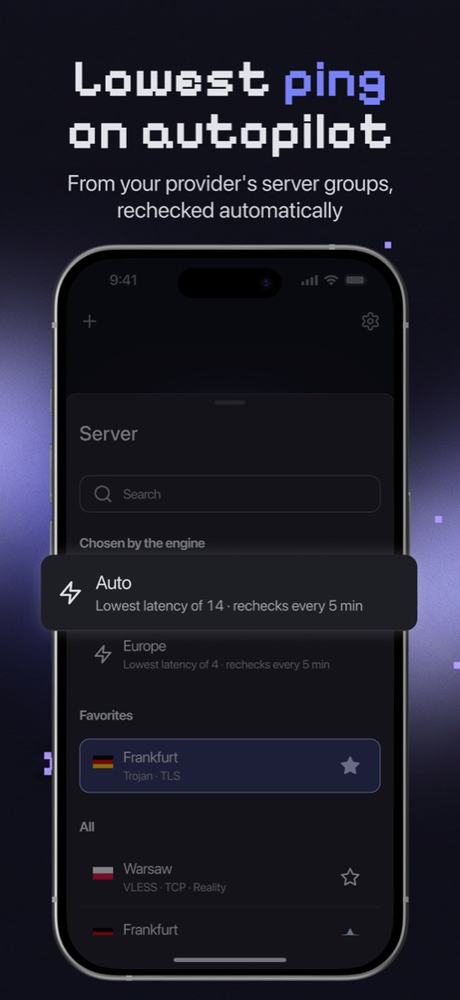
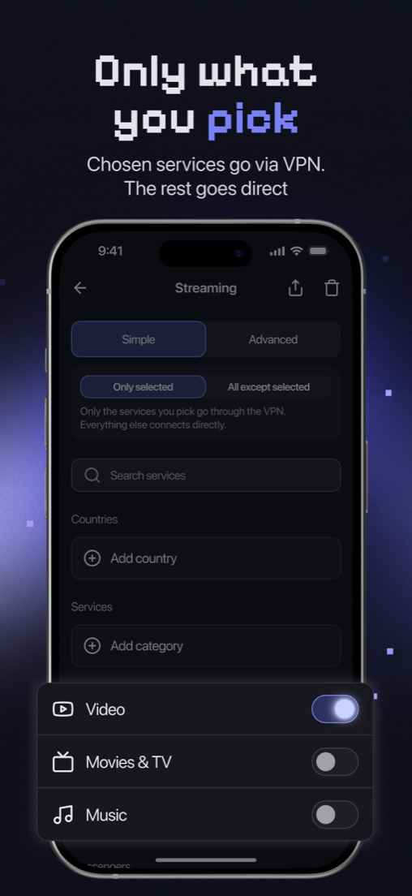
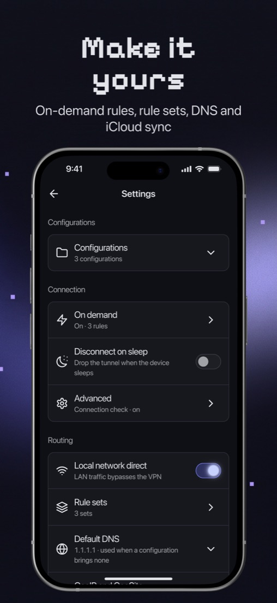

<p align="center">
  <a href="https://anoya.io"></a>
</p>

<h1 align="center">Anoya</h1>

<p align="center">
  A cross-platform VPN client for your own links and subscriptions.<br>
  Android · iOS · macOS · Windows · Linux
</p>

<p align="center">
  <a href="https://github.com/annoya/anoya-client/actions/workflows/build-client.yml"></a>
  <a href="https://github.com/annoya/anoya-client/releases/latest"></a>
  <a href="LICENSE"></a>
</p>

<p align="center">
  <a href="https://anoya.io"><b>Website</b></a> ·
  <a href="https://github.com/annoya/anoya-client/releases/latest"><b>Download</b></a> ·
  <a href="docs/SPEC-CLIENT.md"><b>Specification</b></a>
</p>

<p align="center">
  <a href="https://play.google.com/store/apps/details?id=io.anoya.app"></a>
</p>

<p align="center">
  
  
  
  
  
</p>

One Flutter app on every platform; the tunnel is the
[mihomo](https://github.com/MetaCubeX/mihomo) engine running inside each
platform's system VPN.

## Features

- **Bring your own link** — `vless://`, `vmess://`, `trojan://`, `ss://`,
  `hysteria2://`, `tuic://`, WireGuard and AmneziaWG configs. Paste them, open
  a file, or scan a QR code on a phone.
- **Subscriptions** from panels such as 3x-ui, Marzban, Remnawave and Hiddify:
  base64 link lists, Clash/mihomo YAML, Xray JSON and sing-box JSON. A server
  the engine cannot run is counted and named, never silently dropped.
- **`vpn://` keys** and a **self-hosted management server** with password or
  SSO sign-in.
- **Auto** — picks the lowest-latency server from a group and rechecks it
  periodically.
- **Split tunneling** — a catalog of services and countries ("only selected" /
  "all except selected"), or ordered rules of every type in the advanced view;
  per-app exclusions on Android.
- **On-demand** connection rules, rule sets, per-configuration DNS, LAN-direct
  and iCloud sync between Apple devices.
- Interface in English, Russian, Spanish, French and Chinese.

## Download

Builds for every release are on the
[Releases](https://github.com/annoya/anoya-client/releases/latest) page:

| Platform | Package |
|---|---|
| Android | [Google Play](https://play.google.com/store/apps/details?id=io.anoya.app), or `.apk` (universal or per ABI) |
| Windows | installer `.exe` or portable `.zip` |
| Linux | `.deb`, `.rpm`, Arch `.pkg.tar.zst` or portable `.tar.gz` |
| iOS, macOS | [build from source](#building) |

## How it fits together

| Path | What it is |
|---|---|
| `lib/` | The Flutter app. Screens and state reach the tunnel only through `VpnCore` (`lib/core/vpn_core.dart`). |
| `native/mihomocore/` | The Go engine wrapper: an xcframework for Apple, an AAR for Android, a tunnel service for Windows and Linux. |
| `shared/apple/` | The Network Extension and the app's VPN glue, shared by iOS and macOS. |
| `native/libagw/` | The gateway library for `vpn://` keys (a submodule). |

Per platform the tunnel runs as:

| Platform | Tunnel |
|---|---|
| iOS, macOS | Network Extension (`NEPacketTunnelProvider`) |
| Android | `VpnService` |
| Windows | `AnoyaTunnel` service, over a named pipe |
| Linux | `anoya-tunnel` systemd service, over a unix socket |

## Building

You need Flutter, Go and the platform's own toolchain (Xcode, Android SDK,
Visual Studio, or GTK 3 and libsecret headers on Linux). Fetch the submodule
first:

```sh
git submodule update --init --recursive
```

| Platform | Command |
|---|---|
| macOS | `./scripts/build.sh macos` |
| iOS | `./scripts/build.sh ios` |
| Android | `native/mihomocore/build-aar.sh && native/libagw/build-so.sh && ./scripts/build-android.sh` |
| Windows | `./scripts/build-tunnel-service.sh && native/libagw/build-dll.sh`, then `flutter build windows` and the installer in `windows/installer/` |
| Linux | `./scripts/build-tunnel-service.sh linux && native/libagw/build-linux.sh`, then `flutter build linux` and `./scripts/build-linux-packages.sh` |

`scripts/build.sh` rebuilds the Go engine only when it changed. On iOS the
Network Extension needs a real device.

### `vpn://` keys

Key subscriptions need gateway credentials that are not in this repository.
Copy `client-secrets.example.json` to `client-secrets.json` and build with
`--dart-define-from-file=client-secrets.json`. Without them the app builds and
runs, and refuses `vpn://` keys with a message saying so.

## Tests

```sh
flutter analyze
flutter test
```

CI ([`build-client.yml`](.github/workflows/build-client.yml)) runs both and
builds Android, Windows and Linux on every push and pull request.

## Documentation

- [`AGENTS.md`](AGENTS.md) — how to work in this repository.
- [`docs/SPEC-CLIENT.md`](docs/SPEC-CLIENT.md) — what the client does.
- [`docs/decisions/`](docs/decisions/README.md) — why it is built this way.
- [`design/ui-spec.html`](design/ui-spec.html) — every screen, 1:1.

## Built with

- [mihomo](https://github.com/MetaCubeX/mihomo) — the proxy engine
- [Flutter](https://flutter.dev) — the app on every platform
- [sing-tun](https://github.com/MetaCubeX/sing-tun) and [gVisor](https://gvisor.dev) — the TUN stack
- [AmneziaWG](https://github.com/amnezia-vpn/amneziawg-go) — WireGuard with obfuscation
- [Wintun](https://www.wintun.net) — the TUN driver on Windows
- [zxing-cpp](https://github.com/zxing-cpp/zxing-cpp) — QR code scanning

…and more, listed in [`THIRD_PARTY_LICENSES.md`](THIRD_PARTY_LICENSES.md).

## License

Anoya is licensed under the GNU General Public License v3.0 — see
[`LICENSE`](LICENSE). Third-party components are distributed under their own
terms, listed in [`THIRD_PARTY_LICENSES.md`](THIRD_PARTY_LICENSES.md).
